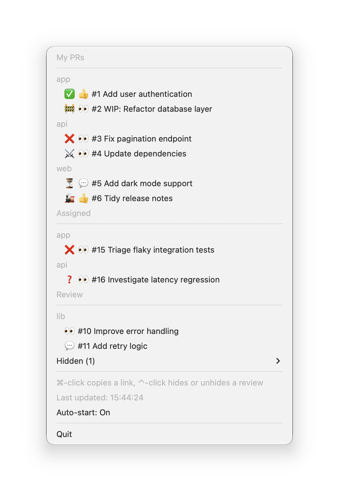

# gh-tray

macOS menu bar app monitoring GitHub pull requests.



## Usage

Click a pull request in the menu to open it in the browser. Hold ⌘ and
click to copy its link to the clipboard instead.

To put a review aside until something changes, hold ⌃ and click it in the
Review group, then choose what to wait for:

- an approval from someone else
- green CI
- resolved conflicts
- a re-request of your review

The pull request moves to the Hidden submenu and leaves the count. When
everything you chose has happened, it returns to Review and gh-tray shows a
notification. To bring it back sooner, hold ⌃ and click it in the Hidden
submenu.

## Installation

```sh
brew tap jsfr/gh-tray-rs https://github.com/jsfr/gh-tray-rs
brew install --cask jsfr/gh-tray-rs/gh-tray
```

### First launch

The `.app` is not code-signed. macOS will block it on first launch with a "cannot verify developer" warning. To bypass:

- Right-click `gh-tray.app` in Finder → Open → Open, **or**
- Run: `xattr -d com.apple.quarantine /Applications/gh-tray.app`
